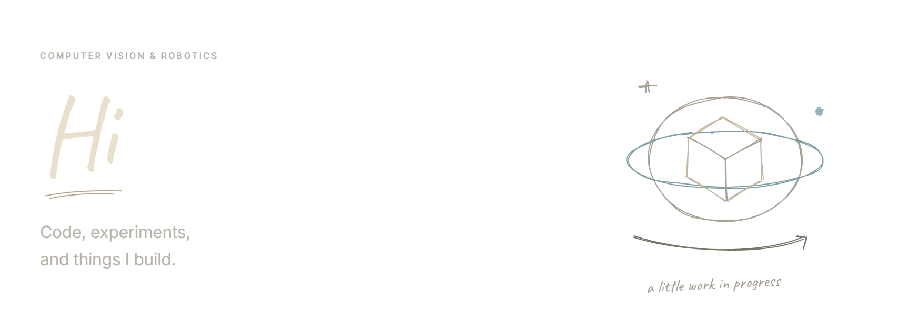
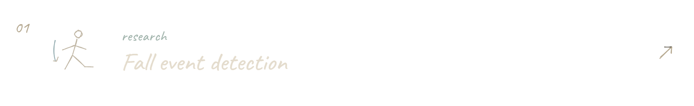
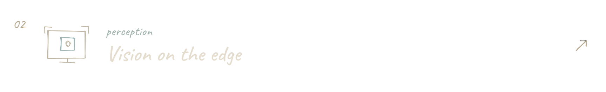
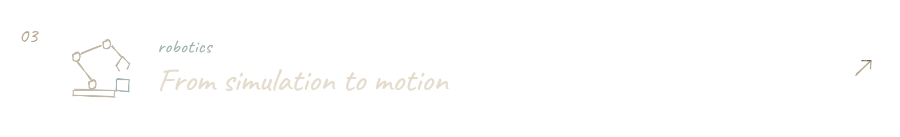
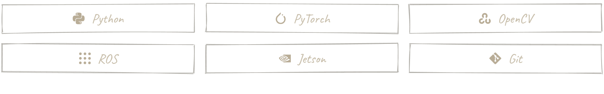
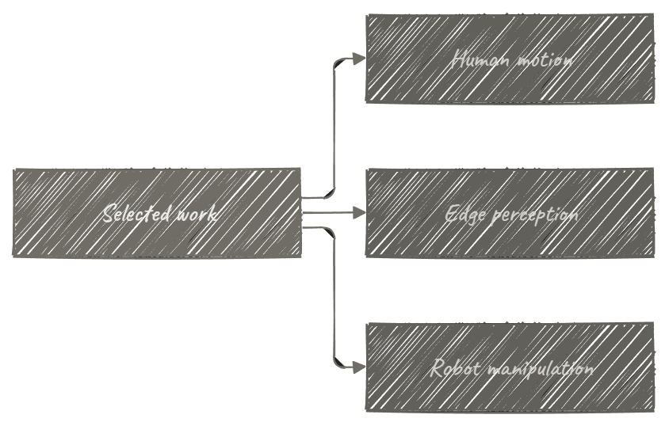

<picture>
  <source media="(max-width: 600px)" srcset="assets/banner-mobile-v4.png" />
  <source media="(max-width: 1279px)" srcset="assets/banner-tablet-v4.png" />
  
</picture>

<picture></picture>

<picture></picture>

<a href="https://github.com/xhr-CHN/causal-rgb-pose-fall-event-detection">
<picture>
  <source media="(max-width: 600px)" srcset="assets/project-1-title-mobile-v4.png" />
  <source media="(max-width: 1279px)" srcset="assets/project-1-title-tablet-v4.png" />
  
</picture>
</a>

<a href="https://github.com/xhr-CHN/jetson-ros2-object-detection">
<picture>
  <source media="(max-width: 600px)" srcset="assets/project-2-title-mobile-v4.png" />
  <source media="(max-width: 1279px)" srcset="assets/project-2-title-tablet-v4.png" />
  
</picture>
</a>

<a href="https://github.com/xhr-CHN/mecharm-fixed-point-pick-place">
<picture>
  <source media="(max-width: 600px)" srcset="assets/project-3-title-mobile-v4.png" />
  <source media="(max-width: 1279px)" srcset="assets/project-3-title-tablet-v4.png" />
  
</picture>
</a>

<picture></picture>

<picture>
  <source media="(max-width: 600px)" srcset="assets/tools-mobile-v4.png" />
  <source media="(max-width: 1279px)" srcset="assets/tools-tablet-v4.png" />
  
</picture>

<picture></picture>

<picture></picture>

[All repositories ↗](https://github.com/xhr-CHN?tab=repositories)

---

<picture></picture>

