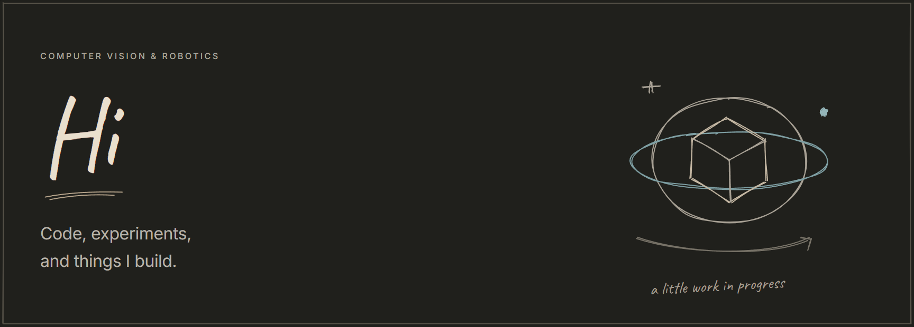
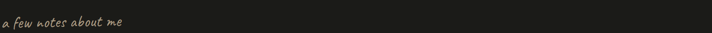
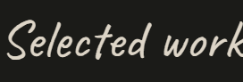
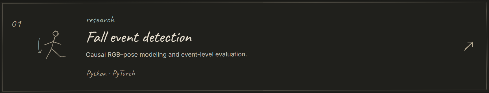
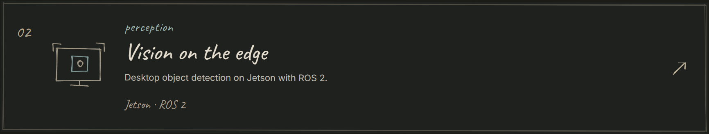
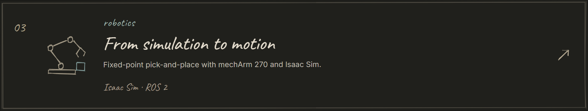
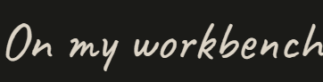
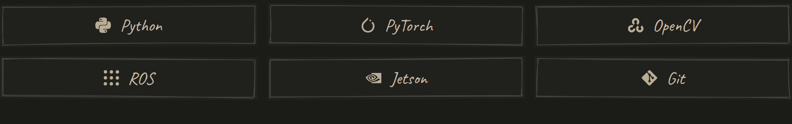
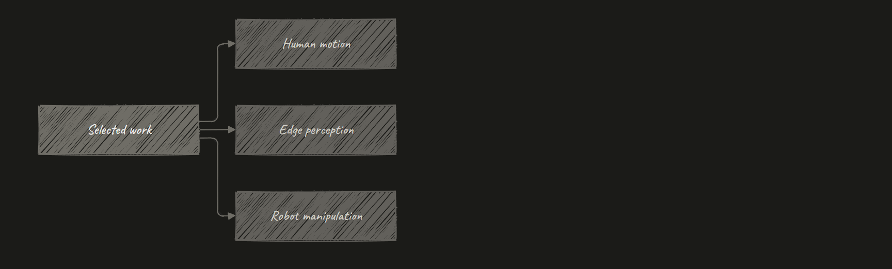
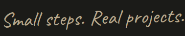

<picture>
  <source media="(max-width: 600px)" srcset="assets/banner-mobile.png" />
  
</picture>

I work on visual perception and robotic systems.  
Here are a few things I've been working on.

<a href="https://github.com/xhr-CHN/causal-rgb-pose-fall-event-detection">
<picture>
  <source media="(max-width: 600px)" srcset="assets/project-1-mobile.png" />
  
</picture>
</a>

<a href="https://github.com/xhr-CHN/jetson-ros2-object-detection">
<picture>
  <source media="(max-width: 600px)" srcset="assets/project-2-mobile.png" />
  
</picture>
</a>

<a href="https://github.com/xhr-CHN/mecharm-fixed-point-pick-place">
<picture>
  <source media="(max-width: 600px)" srcset="assets/project-3-mobile.png" />
  
</picture>
</a>

<picture>
  <source media="(max-width: 600px)" srcset="assets/tools-mobile.png" />
  
</picture>

Project map

GitHub activity

[All repositories ↗](https://github.com/xhr-CHN?tab=repositories)

Research repository

---

